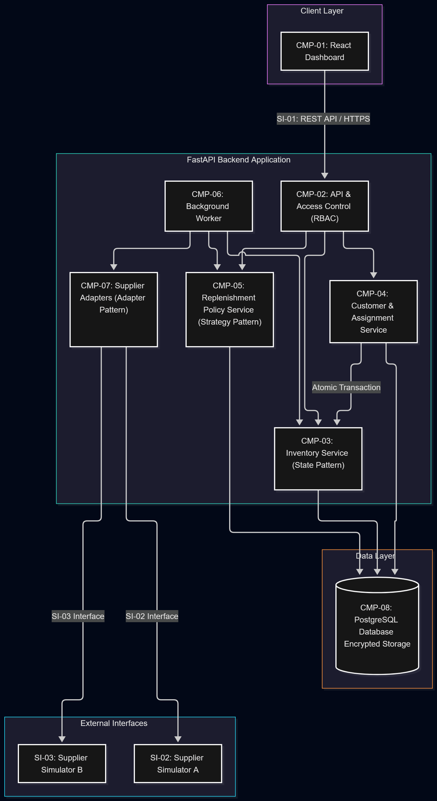
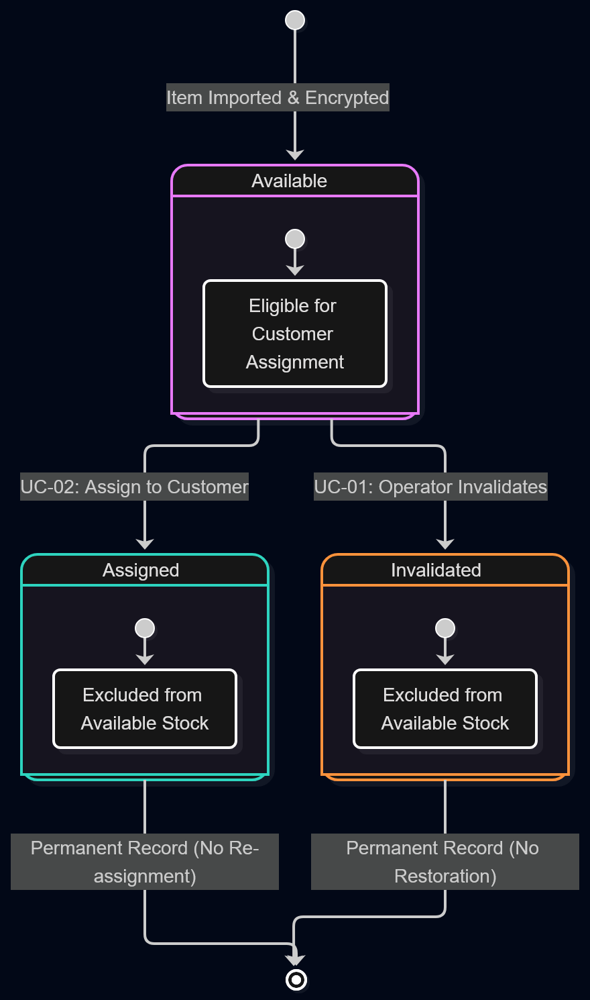

# Software Requirements Document

**Project name:** Talebe Uyarlanabilir Envanter ve Anlık Sipariş Karşılama Sistemi

**Document version:** 0.1 (Initial draft)

**Date:** 11 October 2026

## Document Contributors

| Full name | Student number | Contribution to this document |
| --- | --- | --- |
| Ömer Kılınç | 261111011 | Preparation of the initial requirements, use cases, interface and architecture descriptions, pattern mappings, and traceability. |
| Hasan Yiğit Sarı | 231101050 | Created and integrated the visual Software Architecture Diagram and Item State Lifecycle Diagram. |

## Table of Contents

1. [Product Perspective](#1-product-perspective)
2. [Product Functions](#2-product-functions)
3. [User Characteristics](#3-user-characteristics)
4. [Constraints](#4-constraints)
5. [UML Use Case Diagram](#5-uml-use-case-diagram)
6. [System Features and Use Cases](#6-system-features-and-use-cases)
7. [Nonfunctional Requirements](#7-nonfunctional-requirements)
8. [External Interface Requirements](#8-external-interface-requirements)
9. [Software Architecture Overview](#9-software-architecture-overview)
10. [Pattern and Use Case Mapping](#10-pattern-and-use-case-mapping)
11. [Traceability Matrix](#11-traceability-matrix)
12. [Document Task Matrix](#12-document-task-matrix)

## 1. Product Perspective

The system is an internal digital inventory and fulfillment application for one organization. Staff use a dashboard connected to an API to manage unique digital items, such as license keys, prepaid vouchers, and activation codes. Items are procured in advance, stored encrypted, and assigned to customers from available stock.

Customers are minimal records with no accounts or direct system access. Fulfillment is complete when an item is assigned and its code becomes available to authorized staff. A background process monitors inventory and replenishes it according to demand and stock limits.

This document develops the scope in the [Project Definition Document](../1-Project%20Definition%20Document/project-definition.md) and connects it to the acceptance planning in the [Project Plan Document](../2-Project%20Plan%20Document%3A/project-plan.md). It is an initial specification; implementation and test results are not yet available.

## 2. Product Functions

| Function ID | Function | Description |
| --- | --- | --- |
| FUN-01 | Manage products and items | Maintain product types and import unique digital items into a shared inventory. |
| FUN-02 | Protect digital codes | Encrypt stored codes and restrict their retrieval to authorized staff. |
| FUN-03 | Inspect inventory | Display available quantities and item statuses without exposing codes in inventory lists. |
| FUN-04 | Maintain customer records | Store a customer ID, creation and update timestamps, and an optional email address. |
| FUN-05 | Assign items | Assign each available item to a customer at most once and remove it from available stock. |
| FUN-06 | Preserve assignment history | Retain item and assignment records, including the customer, staff member, and assignment time. |
| FUN-07 | Control staff access | Authenticate staff and enforce Viewer, Operator, and Administrator permissions. |
| FUN-08 | Configure replenishment | Select a replenishment policy and configure valid stock limits and policy parameters. |
| FUN-09 | Replenish stock | Evaluate demand and obtain items in the background through supplier adapters. |

## 3. User Characteristics

| User type | Needs | Skill level | Expected interactions |
| --- | --- | --- | --- |
| Viewer | Visibility into shared stock. | Ordinary browser skills. | Inspect product information, quantities, and item statuses. |
| Operator | Tools for daily inventory and assignment work. | Ordinary browser skills and familiarity with the organization's products. | Import items, maintain customers, assign items, inspect history, and retrieve assigned codes. |
| Administrator | Control over staff access and replenishment behavior. | Browser skills and an understanding of inventory policies. | Perform operator tasks, manage staff accounts and roles, and configure replenishment. |

Customers are recipients recorded by staff and do not operate the software. Supplier simulators are external software participants rather than staff users.

## 4. Constraints

| Constraint ID | Constraint | Description or source |
| --- | --- | --- |
| CON-01 | Single organization | One shared inventory; no separate organizations, personal inventories, cloning, or splitting. |
| CON-02 | Technical direction | Python/FastAPI backend, PostgreSQL storage, a React dashboard, and a Python background worker in the same backend codebase. Vite versus Next.js remains open. |
| CON-03 | Limited customer model | Customers have an ID, timestamps, and optional email; they have no credentials, role, or API access. |
| CON-04 | Fulfillment boundary | Assignment and authorized staff retrieval complete fulfillment. Payments and automatic email delivery are outside the initial scope. |
| CON-05 | Simulated procurement | The initial demonstration uses two simulated suppliers with different interfaces and synthetic codes; no live supplier purchases are required. |
| CON-06 | Item retention and uniqueness | Assigned items remain stored and cannot be returned to available stock or assigned to another customer. |
| CON-07 | Design patterns | Strategy supports replenishment policies, Adapter supports suppliers, and State governs item lifecycle behavior. |
| CON-08 | Initial specification | Diagram artwork is deferred. Open technical decisions must be resolved before their dependent acceptance tests can pass. |

The following are **proposed defaults for this draft**: the system selects an available item for the requested product; empty stock causes immediate rejection without a pending order; repeated requests with the same identity return their original assignment; and Operators may invalidate available items. The use cases and requirements below assume these defaults for review.

Open decisions include the authentication mechanism, frontend framework, exact replenishment formula and demand measurement window, stock-limit values, supplier recovery details, and performance thresholds. Geometric resizing of target stock levels is a candidate replenishment approach. Reducing a target affects future procurement and does not discard existing items.

## 5. UML Use Case Diagram

### 5.1 Diagram

**Diagram artwork: planned.** The UML use case diagram will show Viewer, Operator, Administrator, and external supplier participation around the system boundary, connected to their relevant capabilities. Customers are stored records, and automatic replenishment operates within the system.

### 5.2 Actors and System Boundary

| Participant | Relationship to the system |
| --- | --- |
| Viewer | External staff actor with inventory-reading capabilities. |
| Operator | External staff actor with inventory, customer, assignment, and assigned-code retrieval capabilities. |
| Administrator | External staff actor with operator capabilities plus staff and replenishment administration. |
| Supplier simulator | External software actor participating in UC-04 by receiving procurement requests and returning items or failures. |
| Customer | Internal business record, not a UML actor because the customer has no direct system interaction. |
| Background worker | Internal component; it must not be drawn as an external actor. |

The boundary contains the dashboard, API, business services, database, and worker. Supplier simulators are outside that boundary even when they run locally.

### 5.3 Diagram Explanation

The four core use cases are UC-01 through UC-04. Supporting capabilities include inventory browsing, authentication, customer management, staff administration, and assignment-history access. The Administrator owns the goal and configuration of automated replenishment; stock changes or scheduled checks trigger execution without a manual action for every run.

The role permissions are:

| Operation | Viewer | Operator | Administrator |
| --- | --- | --- | --- |
| View product information, stock counts, and item statuses | Yes | Yes | Yes |
| Create or update product types | No | No | Yes |
| Import items and perform permitted lifecycle operations | No | Yes | Yes |
| View, create, and update customer records | No | Yes | Yes |
| Create assignments and view assignment history | No | Yes | Yes |
| Retrieve an assigned item's code | No | Yes | Yes |
| Create or disable staff accounts and assign roles | No | No | Yes |
| View or change replenishment configuration | No | No | Yes |

All business operations require staff authentication. Permissions are enforced by the API, including requests made without the dashboard.

## 6. System Features and Use Cases

### 6.1 Use Case 1

| Field | Value |
| --- | --- |
| Use case ID | UC-01 |
| Title | Manage digital inventory items |
| Main actor | Operator; Administrator can perform the same operations. |
| Goal | Add valid digital items to stock and manage their permitted lifecycle operations. |
| Preconditions | The staff member is authenticated and authorized; the product type exists; secure storage is configured. |

#### Main Flow

| Step | Actor | Action |
| --- | --- | --- |
| 1 | Operator | Select a product type and provide one or more digital items for import. |
| 2 | System | Validate the item data and check for duplicate codes, including codes in retained assigned or invalidated records. |
| 3 | System | Encrypt each accepted code and create a permanent item record in the Available state. |
| 4 | System | Update the available-stock view and make the stock change available to replenishment evaluation. |
| 5 | System | Return the import result and item metadata without exposing codes in inventory lists. |
| 6 | Operator | Inspect the resulting quantities and statuses. |

#### Alternative Flows and Exceptions

| Condition | System response | Outcome |
| --- | --- | --- |
| Input is invalid or duplicates a stored item | Reject the affected item with a clear reason. For a batch, identify accepted and rejected entries. | Rejected entries do not increase stock. |
| Encryption or persistence fails for an item | Do not create an available record for that item; report the failure without exposing its code. | Stored records and stock counts remain consistent. |
| Operator requests invalidation of an Available item | Change the item to Invalidated, preserve its record, and update available stock. | The item is no longer assignable. |
| Staff attempts to assign, invalidate, or restore an item contrary to its state rules | Reject the transition. | An Assigned or Invalidated item cannot become Available or be assigned again under this draft. |
| Caller lacks permission | Deny the operation. | Inventory remains unchanged. |

#### Postconditions

Accepted items exist as encrypted permanent records and contribute to available stock. Invalidated items remain recorded but are excluded from that stock. No import or lifecycle operation creates an assignment.

### 6.2 Use Case 2

| Field | Value |
| --- | --- |
| Use case ID | UC-02 |
| Title | Assign an item to a customer |
| Main actor | Operator; Administrator can perform the same operations. |
| Goal | Fulfill a customer request from available stock and make the assigned code retrievable by authorized staff. |
| Preconditions | The staff member is authenticated and authorized; a customer and product are selected; the assignment request has a unique request identity. |

#### Main Flow

| Step | Actor | Action |
| --- | --- | --- |
| 1 | Operator | Select an existing customer or create a minimal customer record. |
| 2 | Operator | Request one item of the selected product type using a request identity retained across retries. |
| 3 | System | Check whether the same staff member's request identity already has a result; otherwise select an available item. |
| 4 | System | Create the assignment and change the item from Available to Assigned in one atomic operation. Record the customer, staff member, and assignment time. |
| 5 | System | Return assignment metadata, exclude the item from available stock, and make the stock change available to replenishment evaluation. |
| 6 | Operator | Request the assigned code. |
| 7 | System | Recheck access, retrieve and decrypt the assigned item's code, and return it to the authorized staff member. |

#### Alternative Flows and Exceptions

| Condition | System response | Outcome |
| --- | --- | --- |
| No available item exists | Reject the request with an out-of-stock response. | No assignment or pending order is created. |
| A completed request is retried with the same identity and inputs | Return the original assignment after checking current access rights. | No additional stock is consumed. |
| The same request identity is reused with different inputs | Reject the conflicting request. | The original assignment is unchanged. |
| Simultaneous requests compete for available items | Enforce assignment uniqueness and atomic state changes. | Each item is assigned at most once; unsuccessful requests receive an appropriate result. |
| An assignment fails before commit | Roll back its changes. | No partial assignment or inconsistent item status remains. |
| The response is lost after commit, or code retrieval fails | Preserve the completed assignment and allow retrieval or retry of that same assignment. | A replacement item is not automatically allocated. |
| Caller lacks permission, or a customer/product reference is invalid | Deny or reject the request. | No unauthorized assignment or disclosure occurs. |

#### Postconditions

A successful request has one permanent assignment linking one item to one customer. The item is Assigned and excluded from available stock. The record and code remain available through authorized assignment-history access.

### 6.3 Use Case 3

| Field | Value |
| --- | --- |
| Use case ID | UC-03 |
| Title | Configure replenishment policy |
| Main actor | Administrator |
| Goal | Define how the system replenishes a product according to demand and stock limits. |
| Preconditions | The Administrator is authenticated; the product exists; supported strategies and their parameter rules are defined. |

#### Main Flow

| Step | Actor | Action |
| --- | --- | --- |
| 1 | Administrator | Open the product's replenishment configuration. |
| 2 | System | Display the current strategy, stock limits, and policy parameters. |
| 3 | Administrator | Select a strategy and enter the required settings. |
| 4 | System | Validate the strategy and its parameters, including internally consistent stock limits. |
| 5 | System | Save the valid configuration and display confirmation. |
| 6 | System | Use the accepted configuration for subsequent replenishment evaluations. |

#### Alternative Flows and Exceptions

| Condition | System response | Outcome |
| --- | --- | --- |
| Unsupported strategy, invalid parameter, or inconsistent stock limits | Reject the configuration and explain the invalid fields. | The previous valid configuration remains active. |
| Viewer or Operator attempts configuration access or modification | Deny the request. | Configuration remains unchanged. |
| Saving fails | Report failure and retain the previous configuration. | An incomplete configuration does not become active. |

#### Postconditions

The product has a valid selected policy and parameter set for future evaluations. Changing configuration does not delete existing items or alter completed assignments.

### 6.4 Use Case 4

| Field | Value |
| --- | --- |
| Use case ID | UC-04 |
| Title | Replenish inventory from suppliers |
| Main actor | Administrator as policy owner and beneficiary; execution is automatic and has no direct human initiator for each run. |
| Supporting actor | Supplier simulator |
| Trigger | A relevant stock change or a scheduled inventory check. |
| Goal | Obtain valid digital items when the selected policy determines that replenishment is needed. |
| Preconditions | A valid product policy exists; demand and stock inputs are available; a supplier adapter is configured; the background worker can run. |

#### Main Flow

| Step | Actor | Action |
| --- | --- | --- |
| 1 | System | Detect a stock change or run a scheduled inventory check. |
| 2 | System | Read current stock, relevant demand information, and replenishment configuration. |
| 3 | System | Ask the selected Strategy for a replenishment decision within configured limits. |
| 4 | System | When procurement is needed, send the request through the configured supplier adapter. |
| 5 | Supplier simulator | Return digital items or a supplier result through its own interface. |
| 6 | System | Normalize the response, validate returned items, reject duplicates, encrypt accepted codes, and add accepted items to available inventory. |
| 7 | System | Record the outcome and update the stock view. |

#### Alternative Flows and Exceptions

| Condition | System response | Outcome |
| --- | --- | --- |
| The policy requests no replenishment | Complete the evaluation without procurement. | Inventory is unchanged. |
| Configuration is missing or invalid | Report the configuration problem and skip procurement. | No unsupported decision is executed. |
| Supplier fails, times out, or returns an uncertain result | Record the outcome and use the defined recovery procedure; do not blindly repeat an unresolved procurement. | Failed or uncertain procurement is not counted as available stock. |
| Supplier returns invalid or duplicate items | Reject affected items and record the accepted/rejected results. | Only valid, unique items increase available stock. |
| Evaluation or recovery runs repeatedly | Avoid duplicate imports and account for existing replenishment work according to the final policy. | Repeated processing does not create duplicate inventory. |
| Demand decreases | Reduce future procurement or target stock as specified by the selected policy. | Existing items and completed assignments remain intact. |

#### Postconditions

Valid procured items are stored encrypted and become available. The attempt and outcome are recorded, stock counts agree with accepted imports, and existing assignments are unchanged. This workflow operates in the background.

### 6.5 Functional Requirements

| Requirement ID | Requirement | Related use case | Acceptance criterion |
| --- | --- | --- | --- |
| FR-01 | Authenticate staff and allow Administrators to create or disable staff accounts and assign roles. | Supporting all four use cases | Valid staff can authenticate; invalid credentials and disabled accounts cannot obtain protected access. |
| FR-02 | Enforce the permission matrix in Section 5.3 at the API. | UC-01, UC-02, UC-03; administration supporting UC-04 | All allowed and denied operations match the matrix, including direct API requests. |
| FR-03 | Allow Administrators to create and update product types. | Supporting UC-01 and UC-03 | Valid changes are reflected in inventory/configuration views without breaking existing item references. |
| FR-04 | Validate item imports, encrypt accepted codes, and prevent reimport of the same code. | UC-01, UC-04 | Accepted unique items increase stock once; invalid or duplicate items do not. |
| FR-05 | Display quantities and statuses, counting only Available items as available stock. | UC-01 | Counts match stored item states; inventory lists exclude digital codes. |
| FR-06 | Permit invalidation of Available items while retaining their records; reject transitions back to Available from Assigned or Invalidated. | UC-01, UC-02 | Permitted transitions succeed and prohibited transitions leave records unchanged. |
| FR-07 | Maintain minimal customer records with IDs, timestamps, and optional email. | Supporting UC-02 | Customers can be created with or without email and updated without creating staff accounts. |
| FR-08 | Assign one available item to one customer and record staff/time details atomically. | UC-02 | No item has more than one assignment; interrupted operations leave no partial result. |
| FR-09 | Identify repeated assignment requests per staff member and return the existing result for matching inputs. | UC-02 | Retries, including simultaneous retries, consume at most one item; conflicting inputs are rejected. |
| FR-10 | Retain assignment history and allow only authorized staff to retrieve an assigned code. | UC-02 | The original item, customer, staff member, and timestamp remain retrievable; unauthorized code access is denied. |
| FR-11 | Reject assignments when stock is empty without creating a pending order. | UC-02 | An out-of-stock request creates no assignment and consumes no stock. |
| FR-12 | Allow only Administrators to select strategies and save valid replenishment parameters. | UC-03 | Invalid changes leave the previous configuration active; subsequent evaluations use accepted changes. |
| FR-13 | Evaluate demand frequency, demand quantity, and stock information in the background. | UC-03, UC-04 | Controlled inputs produce the decisions specified by the selected policy; exact aggregation rules remain to be defined. |
| FR-14 | Procure through two supplier adapters and import only valid, unique results. | UC-04 | Both simulated interfaces support the common procurement workflow and correct stock updates. |
| FR-15 | Preserve consistent stock through supplier failures, repeated results, and recovery. | UC-04 | Failed procurement adds no available stock; recovery does not import duplicate codes. |
| FR-16 | Preserve item and assignment records when stock targets are reduced. | UC-01, UC-03, UC-04 | Lower target levels affect future procurement without deleting stored items or changing assignments. |

## 7. Nonfunctional Requirements

### 7.1 Usability

| Requirement ID | Requirement | Measurable acceptance criterion |
| --- | --- | --- |
| NFR-U01 | Support normal staff work through the dashboard with clear results and validation errors. | In AT-10, staff complete the permitted import/customer/assignment flow and inspect stock/history without database access; invalid actions display a clear outcome. |

### 7.2 Performance

| Requirement ID | Requirement | Measurable acceptance criterion |
| --- | --- | --- |
| NFR-P01 | Inventory reads and in-stock assignments must meet an agreed response-time target under a documented local workload. | AT-14 records response-time percentiles and failures. The workload, dataset, hardware, and numerical pass threshold are pending agreement; this requirement cannot be marked passed until those values are fixed. |
| NFR-P02 | Supplier procurement must run in the background and must not make an in-stock assignment wait for supplier completion. | In AT-18, inventory reads and an in-stock assignment complete while a simulated supplier response remains deliberately delayed. |

### 7.3 Portability

| Requirement ID | Requirement | Measurable acceptance criterion |
| --- | --- | --- |
| NFR-PT01 | Provide reproducible local setup and execution instructions. | In AT-15, at least two members run the documented setup and complete a basic assignment flow on their own computers; environments and results are recorded. |

### 7.4 Reliability

| Requirement ID | Requirement | Measurable acceptance criterion |
| --- | --- | --- |
| NFR-R01 | Preserve assignment uniqueness and consistent item state during failures, concurrency, and retries. | AT-02, AT-03, AT-08, and AT-11 show no duplicate or partial assignments and no unintended additional stock consumption. |
| NFR-R02 | Preserve accurate stock during supplier failures and repeated responses. | AT-09 and AT-13 show that failed procurement and duplicate imports add no false stock and that recovery preserves unique item records. |

### 7.5 Security

| Requirement ID | Requirement | Measurable acceptance criterion |
| --- | --- | --- |
| NFR-S01 | Encrypt stored item codes, keep encryption keys outside the inventory database and Git, and exclude plaintext codes and credentials from application logs. | AT-04 and AT-17 include storage/configuration and log checks using synthetic secrets; authorized retrieval succeeds without exposing plaintext in stock listings or logs. |
| NFR-S02 | Enforce authenticated staff access and role checks. If passwords are managed locally, store them using a maintained password-hashing implementation. | AT-05 and AT-17 verify permitted/denied operations, invalid credentials, disabled accounts, and the absence of plaintext passwords in stored account records. |

The exact authentication mechanism and libraries will be selected during the foundation phase. Customer records are not authentication identities.

## 8. External Interface Requirements

**Applicability:** The system has a browser/API interface and external supplier interfaces. PostgreSQL and security libraries are internal technical dependencies documented here for completeness.

### 8.1 User Interfaces

| Interface ID | Screen or interaction | User type | Description |
| --- | --- | --- | --- |
| UI-01 | Staff login/logout | All staff | Authenticate, display session/access errors, and end access through the selected authentication mechanism. |
| UI-02 | Inventory overview | All staff | Show products, available counts, and item statuses without exposing digital codes. |
| UI-03 | Product and item management | Administrator: product types; Operator/Administrator: items | Maintain product types, import items, inspect import results, and perform allowed lifecycle operations. |
| UI-04 | Customer records | Operator, Administrator | Find, create, and update minimal customer records. |
| UI-05 | Assignments and history | Operator, Administrator | Request an assignment, inspect its customer/item/staff/time details, and explicitly retrieve its code. |
| UI-06 | Staff administration | Administrator | Create or disable staff accounts and assign roles. |
| UI-07 | Replenishment settings | Administrator | Select the strategy, edit parameters and limits, and inspect validation or procurement outcomes. |

The dashboard reflects role permissions, while the API independently enforces them. A retrieved code must not be included in general inventory or history-list responses.

### 8.2 Software Interfaces

| Interface ID | External system or library | Purpose | Data exchanged | Interface requirements |
| --- | --- | --- | --- | --- |
| SI-01 | React dashboard and FastAPI | Staff operations | Product/item metadata, customer records, assignment requests/results, authentication data, and policy settings. | Define request/response validation and errors; retain a request identity for assignment retries; deliver codes only through authorized retrieval. Exact endpoints remain a contract-design task. |
| SI-02 | Supplier simulator A | Provide synthetic items | Product identifier, requested quantity, request reference, returned item codes, and outcome. | Adapter normalizes supplier-specific requests, results, and errors; responses can be controlled for tests. |
| SI-03 | Supplier simulator B | Demonstrate a different supplier interface | Equivalent procurement information in a different supplier-specific contract. | A separate adapter exposes the same internal supplier interface as SI-02. |
| SI-04 | PostgreSQL | Persistent storage | Staff, product, item, customer, assignment, policy, and replenishment records. | Preserve references and uniqueness; support atomic assignment updates; persist encrypted code values. |
| SI-05 | Authentication and cryptographic libraries | Credential handling and code protection | Credentials, protected authentication state, ciphertext, and runtime key references. | Use maintained libraries; avoid implementing custom cryptography; keep real secrets out of source control and logs. |

## 9. Software Architecture Overview

### 9.1 Architecture Style and Rationale

Use a layered application with one backend codebase: API/access control, business services, and persistence/integration components. A React dashboard calls the FastAPI API; a separate Python worker process from the same backend codebase performs replenishment.

This organization separates interface work from inventory rules and supplier details while keeping deployment suitable for a local student-project demonstration. Database safeguards and atomic operations enforce uniqueness across concurrent requests; State defines permitted lifecycle behavior.

### 9.2 Architecture Diagram

**Software Architecture Diagram:**

The architecture diagram shows the React dashboard communicating with FastAPI, which manages business operations and PostgreSQL storage. A background worker evaluates replenishment strategies and obtains digital items through supplier adapters.

**Item State Lifecycle Diagram:**

The state diagram shows an item transitioning from Available to Assigned, with Available to Invalidated under the proposed invalidation rule. Assigned and invalidated items retain their records and are excluded from available stock.

### 9.3 Architectural Components

| Component ID | Component | Responsibilities | Interfaces or dependencies |
| --- | --- | --- | --- |
| CMP-01 | React dashboard | Staff screens, input collection, and presentation of authorized results. | FastAPI through SI-01. |
| CMP-02 | API and access control | Validate requests, authenticate staff, enforce roles, and expose business operations and staff administration. | CMP-03, CMP-04, CMP-05, CMP-08, and authentication libraries. |
| CMP-03 | Inventory service and item states | Product/item management, import validation, code protection, stock views, and permitted lifecycle transitions. | CMP-08 and cryptographic libraries; shared by assignments and procurement. |
| CMP-04 | Customer and assignment services | Minimal customer records, request identity, atomic assignment, retained history, and authorized code retrieval. | CMP-03 and CMP-08; invoked through CMP-02. |
| CMP-05 | Replenishment policy service | Validate settings and select/evaluate the configured Strategy using demand and stock inputs. | CMP-03 and CMP-08; configured through CMP-02 and used by CMP-06. |
| CMP-06 | Background worker | Detect evaluation work, run policy decisions, coordinate procurement, and record outcomes/recovery. | CMP-03, CMP-05, CMP-07, and CMP-08. |
| CMP-07 | Supplier adapters | Translate between a common procurement interface and each simulator's contract. | SI-02 and SI-03; used by CMP-06. |
| CMP-08 | PostgreSQL persistence | Retain business records and enforce data references, unique assignments, and atomic changes. | Accessed by backend services and the worker; not directly by the dashboard. |

### 9.4 Component Interactions

- **Inventory:** CMP-01 sends an import or lifecycle request to CMP-02. After access checks, CMP-03 validates the operation and persists accepted changes through CMP-08.
- **Assignment:** CMP-02 passes an authorized request to CMP-04. CMP-04 resolves the customer and request identity, uses CMP-03's lifecycle rules, and commits the assignment and item state together through CMP-08.
- **Code retrieval:** CMP-02 checks access before CMP-04 retrieves the assigned item through CMP-03. Only the authorized retrieval response contains the decrypted code.
- **Configuration:** CMP-02 allows an Administrator to update a valid policy through CMP-05; CMP-08 retains the accepted settings.
- **Replenishment:** CMP-06 evaluates recorded stock/demand through CMP-05, requests items through CMP-07, and imports accepted results through CMP-03. Stock changes and scheduled checks allow work to be revisited; existing assignments remain independent of supplier response time.

### 9.5 Support for the Use Cases

| Use case ID | Participating components | How the architecture supports the use case |
| --- | --- | --- |
| UC-01 | CMP-01, CMP-02, CMP-03, CMP-08 | Authorized imports and lifecycle operations use shared inventory rules and persistent item records. |
| UC-02 | CMP-01, CMP-02, CMP-03, CMP-04, CMP-08 | Customer management, state rules, request identity, and database safeguards produce one consistent assignment. |
| UC-03 | CMP-01, CMP-02, CMP-05, CMP-08 | Administrators select and validate policies without changing supplier integration or assignment logic. |
| UC-04 | CMP-03, CMP-05, CMP-06, CMP-07, CMP-08 | A background process evaluates strategies, uses interchangeable supplier interfaces, and imports results consistently. |

## 10. Pattern and Use Case Mapping

### 10.1 Mapping Matrix

| Use case ID | Design pattern | Why it is appropriate | Application in the architecture | Flexibility, modularity, or maintainability benefit |
| --- | --- | --- | --- | --- |
| UC-01 | State | Permitted item operations depend on the item's lifecycle state. | CMP-03 delegates lifecycle behavior to state objects. | Keeps transition rules together and makes prohibited operations explicit. |
| UC-02 | State | Only an Available item can become Assigned. | CMP-04 invokes CMP-03's assignment transition within an atomic persistence operation. | Reuses the same state rules across API and other business flows. |
| UC-03 | Strategy | Replenishment policies and their parameters may change. | CMP-05 selects an implementation of a common policy interface. | Allows policy changes without rewriting inventory or supplier code. |
| UC-04 | Adapter, supported by Strategy | Suppliers expose different contracts, while replenishment requires a consistent interface and policy decision. | CMP-07 translates supplier interactions; CMP-05 supplies the procurement decision to CMP-06. | Isolates supplier-specific formats/errors and separates procurement policy from integration details. |

Participant names below are proposed design names, not implemented classes.

### 10.2 Pattern Explanation for Use Case 1

**Pattern name:** State.

**Justification:** Availability, assignment, and invalidation affect which operations an item permits. These rules should be consistent wherever an item is accessed.

**Participants and responsibilities:** InventoryItem is the context; ItemState defines lifecycle operations; AvailableState, AssignedState, and the proposed InvalidatedState implement permitted behavior.

**Application in the architecture:** CMP-03 creates accepted imports in AvailableState and delegates lifecycle requests to the active state. Assigned and Invalidated states reject reassignment and restoration to available stock under this draft.

**Expected benefits and tradeoffs:** State centralizes behavior and supports future lifecycle changes. It introduces additional classes for a small initial lifecycle; merely storing a status label would not demonstrate the pattern's behavioral role.

### 10.3 Pattern Explanation for Use Case 2

**Pattern name:** State.

**Justification:** Assignment must use the same availability rules as inventory management and must not permit reuse of an assigned or invalidated item.

**Participants and responsibilities:** The assignment service coordinates the request, InventoryItem delegates to ItemState, and AvailableState permits the transition to AssignedState.

**Application in the architecture:** CMP-04 requests the state transition through CMP-03 and persists the item change and assignment together. AssignedState rejects a new assignment; a retry instead resolves the original assignment through its request identity.

**Expected benefits and tradeoffs:** Reusing State avoids divergent transition rules. State alone does not prevent races across requests; database uniqueness and atomic operations remain necessary.

### 10.4 Pattern Explanation for Use Case 3

**Pattern name:** Strategy.

**Justification:** The system should support policy changes as demand and stock-management needs evolve.

**Participants and responsibilities:** The policy service is the context; ReplenishmentStrategy defines the decision interface. A fixed-threshold baseline and a demand-adaptive implementation are proposed for demonstrating interchangeable policies.

**Application in the architecture:** CMP-05 selects the configured strategy and provides stock, demand, and validated settings. The strategy returns a replenishment decision; supplier calls remain the worker's responsibility.

**Expected benefits and tradeoffs:** Policies can be tested and changed independently of procurement. Each strategy needs defined parameters and expected results; the adaptive formula, including possible doubling/halving behavior, remains to be specified.

### 10.5 Pattern Explanation for Use Case 4

**Pattern name:** Adapter, supported by Strategy.

**Justification:** The two simulated suppliers use different contracts, but the worker needs one internal way to request and receive digital items.

**Participants and responsibilities:** SupplierClient defines the common interface; SupplierAAdapter and SupplierBAdapter translate supplier requests, responses, and errors; the background worker is the client. The policy service supplies the Strategy decision.

**Application in the architecture:** CMP-06 obtains a decision from CMP-05, invokes CMP-07 through SupplierClient, and sends normalized results to CMP-03 for validation and storage.

**Expected benefits and tradeoffs:** Adding or changing a supplier is isolated to its adapter. Translation requires supplier-specific tests; adapters do not replace validation, duplicate protection, or recovery handling.

## 11. Traceability Matrix

### 11.1 Requirement and Design Traceability

Implementation references are marked Planned until code exists. AT-01 through AT-10 refer to the planned tests in the Project Plan Document. Additional checks are defined in Section 11.2; all test references describe future verification, not passing results.

| Use case ID | Requirement ID | Architecture component | Design pattern | Implementation reference | Test ID |
| --- | --- | --- | --- | --- | --- |
| UC-01 | FR-03, FR-04, FR-05, FR-06 | CMP-01, CMP-02, CMP-03, CMP-08 | State | Planned | AT-01, AT-04, AT-10, AT-12, AT-13, AT-19 |
| UC-02 | FR-07, FR-08, FR-09, FR-10, FR-11 | CMP-01, CMP-02, CMP-03, CMP-04, CMP-08 | State | Planned | AT-02, AT-03, AT-04, AT-05, AT-08, AT-10, AT-11, AT-19 |
| UC-03 | FR-12, FR-16 | CMP-01, CMP-02, CMP-05, CMP-08 | Strategy | Planned | AT-05, AT-06, AT-16 |
| UC-04 | FR-04, FR-13, FR-14, FR-15, FR-16 | CMP-03, CMP-05, CMP-06, CMP-07, CMP-08 | Adapter and Strategy | Planned | AT-01, AT-06, AT-07, AT-09, AT-13, AT-18 |
| UC-01, UC-02, UC-03, UC-04: supporting access and storage controls | FR-01, FR-02, NFR-S01, NFR-S02 | CMP-02, CMP-03, CMP-04, CMP-08 | Cross-cutting controls supporting the mapped patterns | Planned | AT-04, AT-05, AT-17 |
| UC-01, UC-02: usability and portability | NFR-U01, NFR-PT01 | CMP-01, CMP-02, CMP-03, CMP-04, CMP-08 | Cross-cutting qualities supporting State-based operations | Planned | AT-10, AT-15 |
| UC-01, UC-02, UC-04: performance and reliability | NFR-P01, NFR-P02, NFR-R01, NFR-R02 | CMP-02, CMP-03, CMP-04, CMP-06, CMP-07, CMP-08 | State, Strategy, and Adapter with persistence safeguards | Planned | AT-02, AT-03, AT-08, AT-09, AT-11, AT-13, AT-14, AT-18 |

### 11.2 Additional Planned Acceptance Checks

These checks extend the initial Project Plan's test set to cover the requirements developed here. Incorporate them into the shared acceptance plan during the next document alignment review.

| Test ID | Related requirements | Scenario and expected result | Status |
| --- | --- | --- | --- |
| AT-11 | FR-08, FR-09; NFR-R01 | Submit the same staff-scoped request identity and inputs sequentially and simultaneously. All successful responses identify one assignment and consume one item; changing the inputs under that identity is rejected. Repeat after simulating a lost response. | Planned |
| AT-12 | FR-05, FR-06 | Invalidate an Available item and verify the stock decrease and retained record. Attempts to assign it or restore Assigned/Invalidated items to Available are rejected. | Planned |
| AT-13 | FR-04, FR-15; NFR-R02 | Reimport codes already held in Available, Assigned, and Invalidated records and replay a supplier result. Duplicates add no stock, create no extra item records, and produce a clear import outcome. | Planned |
| AT-14 | NFR-P01 | Measure inventory-read and in-stock assignment latency, percentiles, and failures under the agreed dataset and load. Record hardware and versions; compare with a numerical target fixed before execution. | Planned; load and threshold pending |
| AT-15 | NFR-PT01 | Two members follow the setup instructions on their own computers and complete an import-to-assignment demonstration. Record successful setup and any instruction corrections. | Planned |
| AT-16 | FR-12, FR-13, FR-16 | Save valid strategy/settings changes and verify the next evaluation uses them; reject unsupported or inconsistent settings without replacing the previous configuration. Lowering targets does not remove existing records. | Planned; policy parameters pending |
| AT-17 | FR-01, FR-02; NFR-S01, NFR-S02 | Test valid/invalid login, logout, account disabling, and role changes against protected requests. Verify password hashes if locally managed, separation of runtime secrets from stored item data/source control, and absence of plaintext credentials/codes in logs using synthetic test secrets. | Planned; authentication mechanism pending |
| AT-18 | FR-13; NFR-P02 | Delay a simulated supplier response while stock is available. Inventory reads and an assignment complete before procurement finishes; later supplier completion preserves consistent stock. | Planned |
| AT-19 | FR-02, FR-03, FR-07 | An Administrator creates/updates a product; an Operator's product-type write is denied. An Operator creates customers with and without email, updates email, and verifies IDs/timestamps and retained assignment references; customer records provide no login capability. | Planned |

## 12. Document Task Matrix

These entries record preparation of this initial document. Diagram descriptions have been drafted; diagram artwork and implementation remain planned.

| Task | Responsible member | Document sections or files | Contribution evidence | Status |
| --- | --- | --- | --- | --- |
| Define product context, functions, users, and constraints | Ömer Kılınç | Sections 1-4 | Initial content in this document; Git commit pending. | Initial draft prepared |
| Describe the use case diagram and system boundary | Ömer Kılınç | Section 5 | Textual diagram description and actor/permission tables; Git commit pending. | Description prepared; artwork planned |
| Define four use cases and functional requirements | Ömer Kılınç | Section 6 | Initial use case flows, exceptions, and FR-01 through FR-16; Git commit pending. | Initial draft prepared |
| Define quality and interface requirements | Ömer Kılınç | Sections 7-8 | Initial requirements and interface tables; Git commit pending. | Initial draft prepared; listed decisions open |
| Describe architecture and supporting diagrams | Hasan Yiğit Sarı & Ömer Kılınç | Section 9 & architecture-diagram.png & item-state-diagram.png | System architecture diagram and item state diagram. Component descriptions and interactions; Git commit pending. | Description and artwork prepared |
| Explain and justify pattern mappings | Ömer Kılınç | Section 10 | Four use case mappings and participant descriptions; Git commit pending. | Initial draft prepared |
| Establish traceability and additional acceptance checks | Ömer Kılınç | Section 11 | Requirement/component/test mappings and planned checks; Git commit pending. | Initial draft prepared |
| Prepare document structure and contribution records | Ömer Kılınç | Front matter, table of contents, and Section 12 | Initial content in this document; Git commit pending. | Initial draft prepared |
