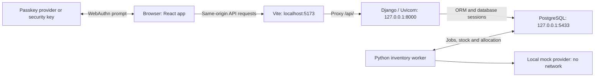

# Architecture

This directory documents the **implemented system** in BIL-482-GRUP-PROJESI. Start here to locate the parts involved in a change, then check the linked source. Keep the affected architecture guides accurate whenever implementation or interfaces change.

The [project README](../../README.md#documentation) links the existing course definition, plan, and requirements, along with the imported exploratory notes and implementation plan. Those documents describe broader goals and earlier design proposals. These architecture guides describe the current Django prototype.

The [PA2 Software Design Document](../4_Software%20Design%20Document.md) is the course submission draft for UC-04, with brief descriptions for diagrams the team will prepare. It follows the assignment outline, describes the current implementation, and marks the remaining pattern and requirements work. The [initial implementation plan](1_initial-setup-plan.md) in this directory is historical planning, not a current behavior reference.

## Current scope

Inventory Manager is a local passkey account application with a single mock digital product. Signed-in users order stored links; a background worker fulfills pending orders and replenishes a small stock buffer. Recovery, additional-passkey enrollment, credential revocation, real providers/payments, deployment, chat, and native mobile support are not implemented.

## System map

The browser gets account and inventory data through Django. Django owns account access, passkey verification, order ownership and allocation. The worker shares Django's models/services and stores provider results before assignment. The passkey provider controls private keys; Django stores public keys. The Vite proxy keeps local browser requests on one origin, so no separate CORS setup is used.

## Guides

| Document | Owns |
| --- | --- |
| [Authentication](authentication.md) | Account data, API contract, signup/signin flows, frontend session state, authentication constraints and limitations. |
| [Inventory](inventory.md) | Product/order ownership, allocation transactions, durable jobs, provider contract, retries, API and polling. |
| [Local runtime](local-runtime.md) | Processes, configuration, PostgreSQL isolation, start/stop/clear behavior, generated files and maintenance. |
| [Project README](../../README.md) | Quick start, available commands, static checks and the manual walkthrough. |

## Code boundaries

| Area | Responsibility and entry points |
| --- | --- |
| Django configuration | [settings.py](../../backend/config/settings.py), [urls.py](../../backend/config/urls.py), and [asgi.py](../../backend/config/asgi.py) configure the database, sessions, middleware, API routing and server entry point. |
| Authentication API boundary | [api/urls.py](../../backend/api/urls.py) maps auth routes; [views.py](../../backend/api/views.py) handles HTTP and login/logout; [serializers.py](../../backend/api/serializers.py) defines input validation and public account fields; [errors.py](../../backend/api/errors.py) normalizes handled errors across APIs. |
| Account logic and storage | [services.py](../../backend/api/services.py) owns passkey ceremonies, verification, transactions and rate limits. [models.py](../../backend/api/models.py) and [migrations/](../../backend/api/migrations/) own schema and constraints. [authentication.py](../../backend/api/authentication.py) enforces CSRF and loads active session users. |
| Inventory logic and worker | [api/inventory/](../../backend/api/inventory/) separates HTTP contracts, allocation services, provider adapters and the worker loop within the same Django app. [inventory_worker.py](../../backend/api/management/commands/inventory_worker.py) is the process entry point. Inventory models/migrations share the existing schema files. |
| Frontend navigation and state | [App.tsx](../../frontend/src/App.tsx) restores account state and gates routes. [pages/](../../frontend/src/pages/) contains signup, signin and account UI; [styles.css](../../frontend/src/styles.css) owns plain CSS styling. |
| Frontend protocol helpers | [lib/api.ts](../../frontend/src/lib/api.ts) handles `/api/v1/` fetch, CSRF, cancellation and HTTP errors. [lib/auth.ts](../../frontend/src/lib/auth.ts) coordinates WebAuthn; [lib/inventory.ts](../../frontend/src/lib/inventory.ts) supplies typed inventory calls to [components/](../../frontend/src/components/). |
| Local lifecycle | [makefile](../../makefile) invokes [start.sh](../../scripts/start.sh), [stop.sh](../../scripts/stop.sh), and [clear.sh](../../scripts/clear.sh). Shared locking and process helpers live in `stop.sh`. [setup_local.py](../../backend/setup_local.py) prepares secrets, the isolated cluster, and the application database. |

Keep views and pages focused on their boundaries. Extend the existing service and helper layers for shared behavior. There is one Django `api` app and one inventory worker, with no external authentication service or task broker.

## Design choices

- One Django app and shared frontend helpers keep the local application together. Inventory has a focused package without introducing another framework or service.
- PostgreSQL holds sessions, pending ceremonies, rate counters, orders, inventory and acquisition jobs. Transactions coordinate backend processes without adding another datastore or queue.
- Product row locks serialize allocation; a session advisory lock limits replenishment to one worker. Durable request IDs support recovery across order retries and interrupted provider calls.
- WebAuthn libraries handle browser serialization and cryptographic verification. The application owns account binding, challenges, session policy and credential lifecycle decisions.
- A separate local PostgreSQL cluster makes full project resets possible while preserving the user's existing Homebrew databases.

## Where to document a change

| Change | Review and update |
| --- | --- |
| Accounts, passkeys, sessions, recovery or auth endpoints | Authentication guide, affected backend code/migrations and frontend helpers/pages. |
| Products, orders, allocation, providers, replenishment or demo controls | Inventory guide, shared schema, inventory components/helpers; local runtime guide for worker changes. |
| Routes, refresh behavior or auth error handling | Authentication guide and the frontend boundaries above. |
| Ports, environment, dependencies, startup or storage cleanup | Local runtime guide and README commands. |
| New feature area, service or boundary | This index and an existing or new focused architecture document. |
| Styling or copy without a behavior change | Check the relevant guide; no architecture edit is needed if it remains accurate. |

Version pins belong in [backend/requirements.txt](../../backend/requirements.txt), [frontend/package.json](../../frontend/package.json), and [frontend/package-lock.json](../../frontend/package-lock.json). Architecture documents explain responsibilities and constraints rather than duplicating dependency inventories.
