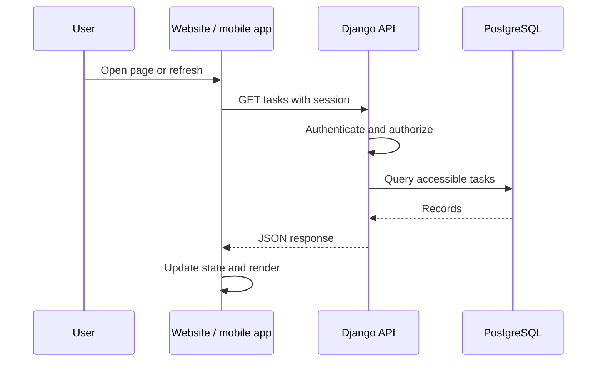
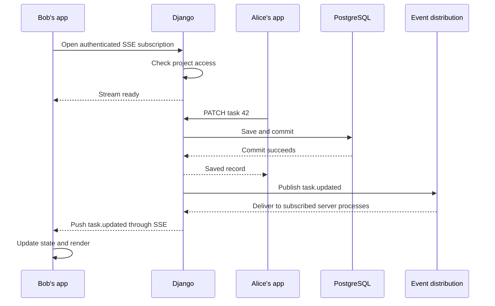

# Data updates: client requests and server push

Status: proposed design for our Python backend, website, and mobile apps. The examples explain the flow; they are not a complete implementation. No application code or infrastructure has been initialized by this document.

The two approaches complement each other. Client requests load data and submit changes. Server push keeps connected clients informed about changes made elsewhere. In both cases, frontend code updates the screen after receiving data.

## 1. Client-requested updates

### 1.1. What starts an update

The app explicitly asks our backend for data. Typical triggers include opening a page, pulling to refresh, changing a filter, returning to the app, or reconnecting after being offline.

For example, opening a project's task list could request:

```http
GET /api/projects/17/tasks/
```

This asks for the current task data. It does not subscribe to future changes. Another request is needed to retrieve later changes unless we also establish a live subscription.

### 1.2. Suggested frameworks and libraries

| Component | Suggested choice | Role |
| --- | --- | --- |
| Python application | Django | Routing, account integration, database access, and application logic. |
| Resource API | Django REST framework, or DRF | Convert records to JSON, validate incoming data, organize permissions, and paginate lists. |
| Website HTTP client | Built-in browser `fetch()` | Send requests and read responses. No extra request library is needed initially. |
| Native mobile HTTP client | The networking client appropriate to the chosen mobile framework | Call the same API and send the mobile session credential. We will select the specific library when choosing the mobile stack. |
| Persistent storage | PostgreSQL | Store the authoritative application records. Clients access these through our backend. |

DRF is an extension to Django. Its serializers describe the fields exposed by the API and validate submitted values. Its permission hooks help organize access checks, but we still have to implement our own ownership and project-membership rules. For a very small prototype, ordinary Django views returning `JsonResponse` are sufficient; DRF is my suggestion for the shared website/mobile resource API. See [Django REST framework](https://www.django-rest-framework.org/) and [Django JSON responses](https://docs.djangoproject.com/en/stable/ref/request-response/#jsonresponse-objects).

The [passkey authentication design](passkey-authentication.md) supplies the session. A normal data request uses that session; it does not repeat the passkey ceremony.

### 1.3. The request flow

1. A page or app event calls a data-loading function.
2. The client sends an HTTPS request to our domain. The website sends its session cookie; the native app sends its session token through the configured authentication mechanism.
3. Django identifies the user and checks whether they may access the requested project and records.
4. The backend queries PostgreSQL, applying access restrictions, filters, and pagination.
5. DRF serializes the permitted fields and returns a JSON response.
6. The client checks whether the request succeeded and parses the JSON.
7. The client updates its local UI state. The frontend renders that state on screen.



The frontend does not connect directly to PostgreSQL, and the server does not directly redraw the screen. The API transfers data; our frontend decides how to display it.

### 1.4. A website example

Assume our endpoint returns an object containing a `results` array:

```javascript
async function refreshTasks() {
  const response = await fetch("/api/projects/17/tasks/", {
    credentials: "same-origin",
  });

  if (!response.ok) {
    throw new Error(`Could not load tasks: ${response.status}`);
  }

  const data = await response.json();
  setTasks(data.results); // Our frontend's state-update function.
}
```

We would call this function from navigation and refresh handlers. The calling UI also needs loading and error states. In particular, `fetch()` does not treat HTTP error statuses as rejected promises, so checking `response.ok` matters. See [using the Fetch API](https://developer.mozilla.org/en-US/docs/Web/API/Fetch_API/Using_Fetch).

When users change pages or filters quickly, we should cancel obsolete requests or ignore their results. Otherwise, a slower response for an old screen could overwrite newer data.

### 1.5. Submitting changes

Reading and writing are separate operations. To mark a task complete, the app might send:

```http
PATCH /api/tasks/42/
Content-Type: application/json

{"status": "completed"}
```

The server authenticates the request, checks permission to modify that task, validates the values, and saves the change. It can return the saved record, which the requesting app uses immediately. A second fetch is only necessary if other displayed data also needs refreshing.

For browser requests authenticated by cookies, state-changing requests must follow our CSRF protection scheme. API permissions must restrict both which records a user can access and which fields they can change.

We can initially update the UI after the server confirms success. An optional later improvement is an optimistic update: show the change immediately, then reconcile or roll back if the server rejects it. Where concurrent edits matter, the API should check a record version or equivalent precondition to avoid silently overwriting someone else's changes.

### 1.6. Periodic and resumed updates

Polling means repeating a normal request on a timer. For example, a status page might refresh every 30 seconds. It is useful when that delay is acceptable, but it creates requests even when nothing changes. Avoid overlapping requests, stop unnecessary timers when a screen is inactive, and back off after failures.

Refreshing when the app reopens or reconnects is useful even if we add server push. The database remains the source of current state; a client should not assume its old screen is still accurate.

## 2. Server-pushed updates

### 2.1. What server push means

The client first opens an authenticated connection or subscription. The server can then send messages over it whenever relevant data changes, without a new client request for each update.

For example, Alice edits a shared task. Bob already has the project open. After Alice's change is saved, our backend sends Bob an event, and his app updates the screen.

The initial connection is still client-initiated. Our server does not open an unsolicited connection into a user's phone or browser.

### 2.2. Recommended starting point: Server-Sent Events

For status changes, shared task lists, and live dashboards, I suggest **Server-Sent Events (SSE)** alongside the regular API.

SSE carries messages from server to client over a long-lived HTTP response. The app continues to submit edits through ordinary API requests. On the website, the browser's `EventSource` API receives the events and supports automatic reconnection. See [SSE documentation](https://developer.mozilla.org/en-US/docs/Web/API/Server-sent_events/Using_server-sent_events).

| Component | Suggested choice | Role |
| --- | --- | --- |
| Streaming endpoint | Django asynchronous view with `StreamingHttpResponse` | Yield SSE messages as they become available. |
| Application server | Uvicorn running Django through ASGI | Serve ordinary requests and long-lived asynchronous connections. |
| Website receiver | Built-in `EventSource` | Open the stream and call our handlers when events arrive. |
| Internal event distribution, when needed | Self-hosted Redis with the Python `redis` package (`redis-py`) | Carry events between the process saving a change and processes serving connected clients. |

ASGI is the interface between an asynchronous Python application and its server. We should use an asynchronous streaming iterator under ASGI; a synchronous streaming deployment can tie up a worker per open stream. DRF remains useful for ordinary JSON endpoints; the SSE endpoint can be a plain Django view. See [Django streaming responses](https://docs.djangoproject.com/en/stable/ref/request-response/#django.http.StreamingHttpResponse) and [Django with Uvicorn](https://docs.djangoproject.com/en/stable/howto/deployment/asgi/uvicorn/).

Redis becomes useful when requests, background jobs, and connected clients are handled by different processes. A Python list or in-memory queue in one process is not shared with the others. `redis-py` provides an asynchronous client suitable for our streaming code. Redis would run on our own infrastructure. See [redis-py asyncio support](https://redis.readthedocs.io/en/stable/examples/asyncio_examples.html).

### 2.3. The server-pushed flow

1. The client opens an event stream for the relevant project or user.
2. Django authenticates it and checks which updates it may receive.
3. The server registers the authorized subscription and keeps the response open.
4. Another user, API request, or background job changes a record.
5. The backend commits the database transaction.
6. Our event-publishing code emits a message describing the committed change.
7. The event reaches the server processes holding the relevant subscriptions, through Redis if necessary.
8. Those processes send authorized messages to connected clients.
9. Each client applies the event or fetches affected data, then updates its UI state.



### 2.4. Where events come from

Saving a PostgreSQL row does not automatically send an SSE message. We must connect the write operation to our event-publishing code.

For changes made by our Django application, use `transaction.on_commit()` to publish after a successful commit. Publishing before commit could tell clients about data that later rolls back, or prompt them to fetch data that is not yet visible. See [Django commit callbacks](https://docs.djangoproject.com/en/stable/topics/db/transactions/#performing-actions-after-commit).

All relevant write paths must participate: ordinary requests, admin actions, and background jobs. Direct SQL changes outside those paths need a separate database change-detection design if they must generate live events.

An after-commit callback alone does not guarantee delivery: the process could stop between committing the row and publishing the message. For critical events, we can store an event record in the same database transaction and have a worker deliver it with retries. This is commonly called a transactional outbox. For ordinary screen refresh hints, refetching on reconnect or periodically may be sufficient.

### 2.5. What the server sends

There are two useful event styles:

| Style | Example | Client behavior |
| --- | --- | --- |
| Include updated data | `task.updated` with task ID, new values, and version | Apply the values directly. No extra fetch is needed for that record. |
| Announce a change | `tasks.changed` with a project ID | Refresh the affected API query. Useful for lists with filtering, sorting, pagination, or derived totals. |

For our first version, I suggest change announcements for complex lists and complete updated records for simple detail views. Events should contain only fields the recipient is allowed to see.

An SSE message containing updated data could look like this. A blank line terminates each message:

```text
event: task.updated
data: {"task":{"id":42,"status":"completed","version":8}}

```

A corresponding website listener is:

```javascript
const events = new EventSource("/api/projects/17/events/");

events.addEventListener("task.updated", (event) => {
  const { task } = JSON.parse(event.data);
  applyTaskUpdate(task); // Our state-update function; check versions here.
});

events.onerror = () => {
  showConnectionStatus(
    events.readyState === EventSource.CLOSED ? "Disconnected" : "Reconnecting"
  );
};

// When the screen no longer needs this subscription:
// events.close();
```

This illustrates receiving events; connection recovery and initial synchronization still need application logic. See [receiving SSE events](https://developer.mozilla.org/en-US/docs/Web/API/Server-sent_events/Using_server-sent_events).

For a same-origin website, `EventSource` fits our cookie session design. Its standard browser interface does not support arbitrary authorization headers. A native app using our session-token design needs an SSE-capable networking client that supports the required header; we will choose that integration with the mobile framework. Do not place reusable session tokens in stream URLs. See [EventSource connection options](https://developer.mozilla.org/en-US/docs/Web/API/EventSource/EventSource).

### 2.6. When to use WebSockets and Django Channels

If the feature needs frequent messages in both directions, such as chat typing indicators, presence, or interactive collaboration, I suggest **WebSockets with Django Channels**.

WebSockets provide a two-way connection. Channels adds WebSocket routing and connection handlers, called consumers, to a Django application. Consumers handle connections and incoming messages and send outgoing events. It also integrates with Django authentication and sessions. See [Channels introduction](https://channels.readthedocs.io/en/stable/introduction.html).

For communication between application processes, use **`channels_redis`**, the production Redis channel layer maintained for Channels. Groups let the application distribute an event to connections associated with a project or another authorized audience. Group membership must be assigned by the server after checking permissions. See [Channels channel layers](https://channels.readthedocs.io/en/stable/topics/channel_layers.html).

We can keep Uvicorn as the ASGI server and continue using HTTP endpoints for ordinary reads and edits. We do not need both SSE and WebSockets for the same feature; choose the transport that fits its communication needs.

### 2.7. Authentication, reconnection, and consistency

Our implementation needs the following behavior:

- **Authorize subscriptions.** A valid session does not grant access to every project. Check the requested audience and permitted fields. Recheck access when permissions change, and close streams when sessions expire or are revoked.
- **Validate browser origins.** Cookie-authenticated WebSockets require origin validation. Channels provides `OriginValidator` and `AllowedHostsOriginValidator`. Native session-token authentication needs its own integration. See [Channels security](https://channels.readthedocs.io/en/stable/topics/security.html).
- **Reconnect and resynchronize.** SSE's reconnection restores the connection, not necessarily missed events. Redis Pub/Sub does not retain messages for disconnected subscribers. Re-fetch current state or implement a durable replay mechanism. See [Redis Pub/Sub delivery semantics](https://redis.io/docs/latest/develop/pubsub/).
- **Handle the initial-load race.** A change can occur between loading a snapshot and opening the stream. Wait for the server to confirm that the subscription is active, buffer events, then fetch initial state and merge using versions. A more advanced design can coordinate a snapshot with an event cursor.
- **Handle duplicates and old data.** A response to the user's own edit and a pushed event may describe the same change. Record versions make applying updates idempotent and prevent older responses from replacing newer state. Handle deletions and changes to list membership too.
- **Keep connections healthy.** Send suitable heartbeats, clean up disconnected subscriptions, and reconnect with backoff. Limit buffering and resynchronize clients that cannot keep up.

An SSE `id` field or WebSocket event identifier only enables replay if our server also stores and retrieves the corresponding history. A transport connection by itself is not a durable event log.

### 2.8. Hosting and mobile app lifecycle

Our planned route remains:

```text
Website / mobile app
        |
        | HTTPS requests and SSE, or secure WebSockets (wss)
        v
Cloudflare named tunnel -> Ubuntu server -> Uvicorn -> Django
                                                     |   |
                                                     |   +-> Redis, when needed
                                                     +-----> PostgreSQL
```

Cloudflare Tunnel supports WebSockets. For SSE, the origin must return `Content-Type: text/event-stream` so the tunnel streams the response; we will also configure caching, buffering, and timeouts appropriately and test through the real public hostname. An IP change or network interruption may disconnect clients, so recovery is still necessary. See [Cloudflare Tunnel connectivity](https://developers.cloudflare.com/learning-paths/prevent-ddos-attacks/advanced/prevent-external-connections/) and [streaming-response troubleshooting](https://developers.cloudflare.com/tunnel/troubleshooting/).

Live streams work while the app can run and maintain its connection. A suspended or terminated mobile app cannot be assumed to keep receiving them. Background push notifications are a separate facility, typically involving APNs on iOS and commonly FCM on Android, with operating-system restrictions. Our baseline can remain live updates while active plus a fresh synchronization when the app reopens. See [Apple background updates](https://developer.apple.com/documentation/usernotifications/pushing-background-updates-to-your-app) and [Android background restrictions](https://developer.android.com/training/monitoring-device-state/doze-standby).

### 2.9. Proposed implementation sequence

1. Build the Django/DRF API and verify authenticated reads, writes, and permissions.
2. Connect client-requested loading, refresh, error handling, and app-resume synchronization.
3. Add SSE for the first feature that benefits from live updates, served asynchronously through Uvicorn.
4. Add Redis event distribution when publishers and subscriptions span processes, and implement reconnect/refetch behavior.
5. Verify concurrent edits, missed events, revoked access, and initial snapshot/subscription timing.
6. Add WebSockets with Channels only for features that need their two-way communication model.
