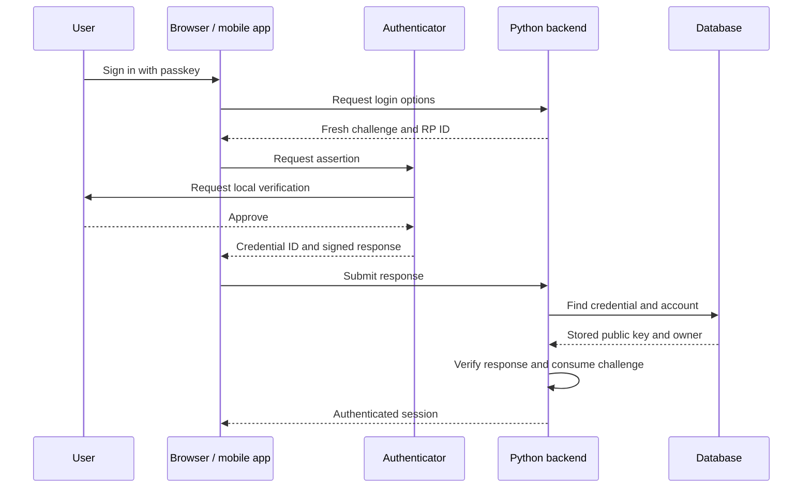

# Passkey authentication with a self-hosted Python backend

Status: proposed implementation plan; no authentication code or infrastructure has been set up. Documentation checked on 23 October 2026.

## 1. The approach we will build

Use **Django + the `webauthn` Python package**, with passkeys as the main authentication method. Our backend will own accounts, verify authentication, issue sessions, and enforce permissions. Signup and login will not require email, SMS, or a social-login provider.

For the initial design, a person chooses an available username and creates a passkey. The username is an account label; the passkey proves control of that account. We will not enable a password-only fallback. Recovery will use another registered passkey or a deliberately implemented recovery-code flow.

| Component | Responsibility |
| --- | --- |
| Django | HTTP endpoints, user accounts, permissions, database access, migrations, and website sessions. |
| `webauthn`, also called py_webauthn | Generate registration/login options and validate WebAuthn responses. |
| Browser or mobile operating system | Present the passkey prompt and communicate with the authenticator. |
| Authenticator or credential manager | Create and protect the private key; approve its use with local user verification. |
| Our application code | Connect verified credentials to users; implement enrollment policy, recovery, rate limits, and session management. |
| Our database | Store users, credential public keys, sessions, and recovery records. PostgreSQL is suitable. |

Django supplies the account and permission foundation. `webauthn` supplies the server-side WebAuthn implementation; it is not a complete account-management service. We will use its verification functions instead of implementing signature verification ourselves. See [Django authentication](https://docs.djangoproject.com/en/stable/topics/auth/default/) and [py_webauthn](https://duo-labs.github.io/py_webauthn/).

**Why choose this over django-allauth for the first version:** allauth supports passkey login, but its built-in passkey signup currently requires mandatory email verification by code. Our email-free signup would therefore need customization. Django with `webauthn` makes that custom account flow explicit and keeps the initial dependency set focused. Allauth remains an alternative if our requirements later change. See [allauth MFA configuration](https://docs.allauth.org/en/latest/mfa/configuration.html).

## 2. What a passkey actually is

A passkey uses a cryptographic key pair associated with an account and a service:

- The **private key** is protected by the user's authenticator or credential manager. Our server never receives it.
- The **public key** is stored by our server. It verifies signatures made with the matching private key.
- The **credential ID** identifies which saved credential the server should look up. Knowing this ID does not let someone log in.

A fingerprint, face scan, or device PIN authorizes use of the private key locally. Our server receives a cryptographic response and verification flags, not the fingerprint, face scan, or PIN. See the [WebAuthn overview](https://developer.mozilla.org/en-US/docs/Web/API/Web_Authentication_API).

Two terms used below: the **Relying Party ID (RP ID)** identifies our service's domain, and a **challenge** is fresh random data generated by the server to bind a response to a particular authentication attempt.

The private key may be synchronized between the user's devices by their chosen credential provider. It may instead live on a hardware security key. Therefore, one passkey does not necessarily mean one physical device.

We do not need “Sign in with Google,” “Sign in with Apple,” or Google Authenticator. Platform passkey APIs and optional credential synchronization serve different roles from social login. The user may choose a provider for storing their passkeys while our backend remains responsible for authenticating their account. See [FIDO's passkey explanation](https://fidoalliance.org/passkeys/).

## 3. How we match a passkey to an account

Conceptually, our records look like this:

```text
User
  id: internal account identifier
  username: "alex"
  webauthn_user_handle: stable, random, opaque identifier

Passkey
  user_id: references Alex's account
  credential_id: identifier returned during registration
  public_key: key used to verify later signatures
  label: "Personal security key"
  metadata: creation time, last use, counter, backup information
```

An account can have several passkey records. We enforce credential-ID uniqueness within our service. The WebAuthn user handle is generated by the server and stays stable when a username changes; it should not contain an email address or other personal information.

At login, the returned credential ID selects a record. The server verifies the response using that record's public key, checks any returned user handle against its owner, and only then logs in the linked account. The client does not get to choose an unrelated account ID to authenticate as. These relationships are described in the [WebAuthn specification](https://www.w3.org/TR/webauthn-3/).

## 4. Signup: creating the first passkey

Our proposed signup ceremony is:

1. The person enters an available username and selects **Create account**.
2. Django creates a short-lived pending signup bound to that client session. It reserves a new internal identity and random WebAuthn user handle. It does not grant normal account access yet.
3. The backend generates registration options: a fresh random challenge, the service's RP ID, user information, and a requirement for user verification. We will request a discoverable credential so username-free login is possible later.
4. The website calls `navigator.credentials.create()` with those options. A native app uses its platform's passkey API.
5. The user approves the operation. The authenticator creates the credential and returns registration data, including the credential ID and public key material.
6. The frontend sends that response to our backend.
7. The backend verifies it against the stored signup state, including the expected challenge, origin, RP ID, and required user verification.
8. Only after successful verification, one database transaction creates the account and links the credential. The pending challenge is consumed once. The server then establishes a session.

The library functions used for options and validation are `generate_registration_options()` and `verify_registration_response()`. See [py_webauthn registration](https://duo-labs.github.io/py_webauthn/registration.html).

**Account ownership rule:** this flow can create a new account. It cannot attach a key to an existing account merely because someone knows its username. Adding a passkey to an existing account requires an authenticated session and recent verification with an existing credential, or the approved recovery process.

**Identity limit:** a passkey proves control of a credential. It does not verify a person's legal identity, their email address, or that they are a unique human. Open signup can still produce duplicate or automated accounts; enrollment restrictions are a separate product decision.

## 5. Login: proving possession of the private key

1. The person selects **Sign in with a passkey**.
2. Our backend generates a new, short-lived challenge and stores it against the pending login session.
3. The website calls `navigator.credentials.get()`; a native app calls its equivalent API.
4. The device offers an eligible passkey. The user approves its use with the required local verification.
5. The authenticator signs data that binds the response to the challenge and service context.
6. The client returns the credential ID, signature, and accompanying WebAuthn data.
7. The backend looks up the credential and checks the signature, challenge, expected origin and RP ID, user verification, credential ownership, and account status.
8. If everything succeeds, it consumes the challenge and establishes an authenticated session.



The corresponding Python functions are `generate_authentication_options()` and `verify_authentication_response()`. Username-free login uses discoverable credentials; the selected credential identifies the account. See [py_webauthn authentication](https://duo-labs.github.io/py_webauthn/authentication.html) and [the server-side authentication flow](https://developers.google.com/identity/passkeys/developer-guides/server-authentication).

## 6. What happens after login

The passkey authenticates the user. A session carries that authentication across later requests, so opening each page does not require another biometric prompt.

For the website, we will use Django's database-backed sessions. The browser receives an opaque session ID in a `Secure`, `HttpOnly`, appropriately scoped `SameSite` cookie. Django's CSRF protection remains enabled for state-changing requests, including authentication endpoints. A passkey-only account will have an unusable Django password; session creation must still reject inactive accounts. See [Django sessions](https://docs.djangoproject.com/en/stable/topics/http/sessions/) and [Django authentication](https://docs.djangoproject.com/en/stable/topics/auth/default/).

For native mobile clients, the proposed design is an opaque, random session token backed by a server-side record. The app stores it using platform-protected storage and sends it in an authorization header. Our database stores a verifier hash rather than the raw token. This mobile session adapter is application work; `webauthn` does not provide it.

Both session types will have server-enforced idle and absolute expiry, revocation, and logout. We will rotate session credentials when authentication changes and track sessions per account so a user can revoke a lost device's session. Sensitive actions, such as adding a passkey, will require recent passkey verification. Session credentials must stay out of URLs and logs. See [OWASP session management](https://cheatsheetseries.owasp.org/cheatsheets/Session_Management_Cheat_Sheet.html).

Authorization remains separate: each endpoint checks whether the authenticated user may access the requested object or perform the requested action. Successful authentication alone does not grant administrative privileges or access to another user's data.

## 7. Website and mobile integration

The clients will share our account records and intended RP identity, while using the appropriate platform API:

| Client | Integration |
| --- | --- |
| Website | Browser WebAuthn: `navigator.credentials.create()` and `navigator.credentials.get()`, served over HTTPS. |
| Android app | Credential Manager; establish the app/domain relationship through Digital Asset Links and `/.well-known/assetlinks.json`. |
| iOS app | AuthenticationServices; configure Associated Domains with `webcredentials` and publish `/.well-known/apple-app-site-association`. |

See [browser WebAuthn](https://developer.mozilla.org/en-US/docs/Web/API/Web_Authentication_API), [Android prerequisites](https://developer.android.com/identity/credential-manager/prerequisites), and [Apple's passkey sample](https://developer.apple.com/documentation/authenticationservices/connecting-to-a-service-with-passkeys).

Our server must validate the expected origin for each supported client. Android native requests, for example, use an origin derived from the app signing certificate; we will explicitly configure permitted production app identities rather than accept arbitrary origins. See [Android server-side passkey verification](https://developer.android.com/identity/passkeys/create-passkeys#verify-origin).

Passkeys are usable on another device when available through synchronization, a compatible security key, or supported cross-device authentication. Availability depends on the user's devices and credential provider; our server cannot copy a private key to a new phone.

## 8. Domain and lab-server hosting

An illustrative deployment is:

```text
Website / mobile app
        |
        | HTTPS to app.example.com
        v
Cloudflare -> named tunnel -> Ubuntu lab server -> Django -> database
```

`app.example.com` is a placeholder for a hostname under your actual domain. A named Cloudflare Tunnel uses outbound connections, allowing this web service to operate behind NAT without a static public IP, provided the network allows the tunnel connection. The lab machine and internet connection must remain available. Cloudflare is part of the traffic path; our application and authentication records remain hosted on the lab server. See [Cloudflare Tunnel](https://developers.cloudflare.com/cloudflare-one/networks/connectors/cloudflare-tunnel/).

For a first deployment hosted entirely at that hostname, we can use:

```text
Website origin: https://app.example.com
RP ID:          app.example.com
```

The RP ID is a domain name, without a scheme or path. We must choose it before real users enroll and validate exact permitted origins. A stable custom hostname lets the server's IP change without changing the passkey identity. Moving to an unrelated domain generally requires a credential migration or new enrollment. See [MDN passkey scope](https://developer.mozilla.org/en-US/docs/Web/Security/Authentication/Passkeys).

We will configure Django's allowed hosts, HTTPS/proxy handling, and CSRF origins for this deployment. Proxy headers will be trusted only from the controlled proxy path. No SMTP server is involved in these signup or login ceremonies.

## 9. Recovery without email

Recovery is part of the account design, not something passkeys automatically solve.

Our proposed policy is:

1. **Encourage a second passkey.** For example, register a separate hardware security key as well as a phone's passkey. Two devices using the same synchronized credential are not independent recovery credentials.
2. **Provide account-recovery codes during onboarding.** Generate random codes with at least 128 bits of entropy each, show them once, and store only verifier hashes. Users keep them offline or in a safe place independent of the lost device.
3. **Restrict what recovery grants.** A valid code creates a short-lived recovery session that can enroll a replacement passkey. It does not immediately grant normal application access. Codes are consumed atomically, once only, and attempts are rate-limited.
4. **Finish recovery explicitly.** After successful replacement enrollment, revoke existing sessions and invalidate the old recovery-code set. Let the user identify and revoke lost credentials, then issue fresh recovery codes.
5. **Define total-loss behavior.** Without any working passkey or recovery code, automatic recovery is unavailable. Any future administrator-assisted recovery needs a credible identity-verification process; a claimed username alone is insufficient.

This is a custom full-account recovery flow. A library's “MFA recovery codes” may only replace a second factor and must not be assumed to recover a passwordless account. Recovery codes are bearer secrets and do not provide passkeys' phishing resistance. See [OWASP recovery and factor replacement guidance](https://cheatsheetseries.owasp.org/cheatsheets/Multifactor_Authentication_Cheat_Sheet.html) and [recovery-token safeguards](https://cheatsheetseries.owasp.org/cheatsheets/Forgot_Password_Cheat_Sheet.html).

## 10. Security requirements for implementation

These are acceptance criteria for our implementation:

- Generate challenges with a cryptographically secure random generator; bind them to the client session, intended operation, and account where known. Give them a short expiry, such as five minutes, and enforce one-time consumption atomically.
- Require user verification in the client options **and** in server verification. A successful device touch alone is not necessarily biometric or PIN verification.
- Pass configured expected origins and RP IDs to the verifier. Do not trust values supplied by the client as the expected values.
- Keep signup, login, passkey enrollment, and recovery states separate. An unfinished ceremony must not authorize normal API access.
- Apply rate limits to ceremony creation, verification, signup, and recovery. Limit abandoned pending records and clean them up.
- Preserve library signature-counter and backup metadata handling. Test synchronized credentials; some authenticators return zero counters, so “every login must increment” is not a universal rule.
- Require recent authentication for credential changes. Prevent removal of the final usable passkey unless a replacement or an explicit account-deletion process is completed.
- Record security events without logging session tokens, recovery codes, or unnecessary personal data. Support credential revocation and session revocation separately.
- Protect database backups and server secrets, and keep dependencies patched. Public keys are not login secrets, but account records and server integrity remain security-critical.

Verification behavior follows the [WebAuthn specification](https://www.w3.org/TR/webauthn-3/); enrollment and recovery controls also draw on [OWASP MFA guidance](https://cheatsheetseries.owasp.org/cheatsheets/Multifactor_Authentication_Cheat_Sheet.html).

## 11. Implementation order

1. Select the permanent hostname and RP ID, and decide whether signup is public or invitation-only.
2. Create the Django project, user model, credential records, and pending-ceremony storage.
3. Implement browser signup and login using `webauthn`, then connect successful verification to Django sessions.
4. Implement credential management, backup enrollment, recovery codes, and session revocation.
5. Verify failure cases: replayed/expired challenges, wrong origins, missing user verification, credential/account mismatch, disabled accounts, concurrent submissions, and unauthorized enrollment.
6. Add native mobile integrations and the mobile session adapter, including app/domain associations and signing-identity checks.
7. Deploy through the named tunnel and test the real HTTPS origin with multiple authenticators, synchronized passkeys, and recovery scenarios.

Passwords, TOTP, and email can be considered later if the product needs them. Each additional login or recovery method would need an explicit policy because it creates another way to access the same account.
